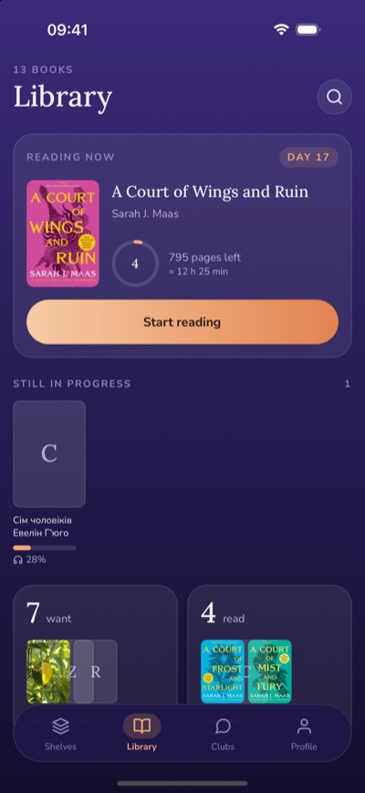
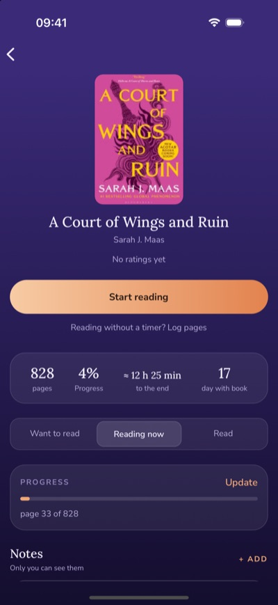
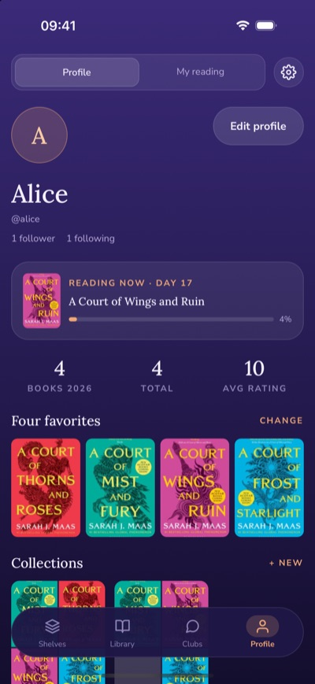
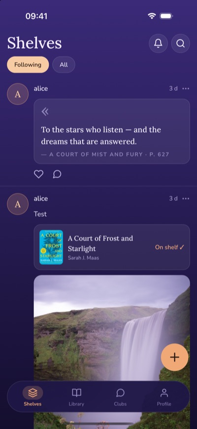
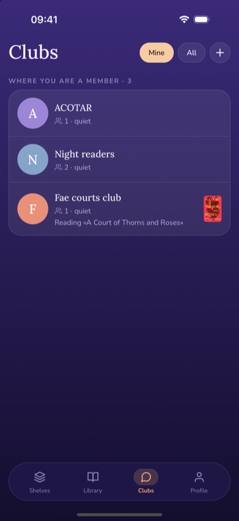
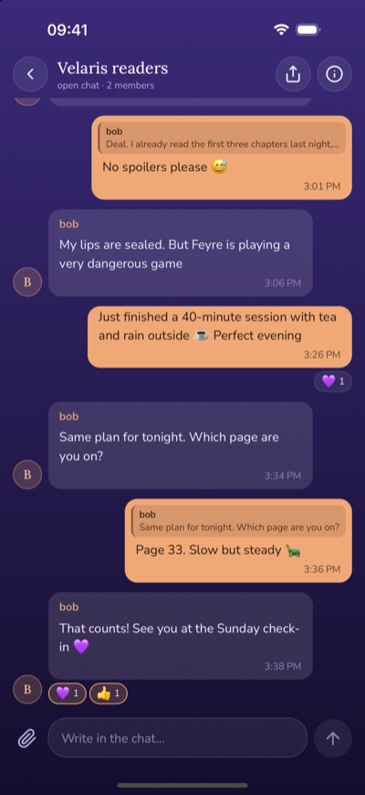

# Reading App

A mobile app for tracking your reading. It has book shelves, a reading timer that works offline, a calendar of what you read each day, and social features: profiles, reviews, collections, a feed and realtime book clubs.

> 📚 A personal pet project. It runs locally only: it isn't deployed or published to any app store.

<p align="center">
  
  
  
</p>

<p align="center">
  
  
  
</p>

## Design credit and disclaimer

The UI design is inspired by the **Readroom** app: its screens, layout and visual style. I used them as a reference while learning. This project is:

- **not affiliated** with Readroom or its authors, and not endorsed by them;
- **non-commercial**: made for personal and educational use only. It isn't sold, published to app stores or offered as a service;
- **not a copy of their code or assets**: all code is written from scratch, and the app uses its own name, colors, fonts and icons.

All rights to the original Readroom design belong to its owners. If you represent Readroom and want something changed or removed, please open an issue and I'll do it.

## Features

| Area | What you can do |
|---|---|
| **Library** | Search books (Google Books, with Open Library as a fallback); add by ISBN or by hand with a cover photo; mark Want / Reading / Read; track progress; see an estimate of the time left |
| **Reading timer** | Start a session from a page or %. The timer survives an app kill and works offline: sessions sync later without duplicates. You can log pages without a timer or jot a quick thought. There is also a "Still reading?" reminder |
| **Native** | iOS Live Activity (lock screen + Dynamic Island), an iOS home screen widget, an Android ongoing timer notification and an Android widget |
| **Stats** | Totals, a monthly calendar with covers (timezone-correct), day details, editing sessions, a year heatmap, a yearly goal and achievements (a nightly job) |
| **Profile & social** | Google sign-in, public profiles, four favorites, follow / followers, 1–10 ratings with reviews (spoiler flag), quotes, private notes, collections with likes |
| **Clubs** | Realtime chat over WebSockets: replies, photos, reactions, unread dots, cursor pagination; deleting your own messages |
| **Feed** | Posts from people you follow or from everyone, likes, comments with replies, in-app notifications |
| **Settings** | Light / dark / system theme, English / Ukrainian, reading reminders, a no-timer mode |
| **Moderation** | Report any user content (books, reviews, posts, comments, messages, profiles); delete your own comments and messages |

Full requirements and the status of each story: [docs/FEATURES.md](docs/FEATURES.md).

## Stack

| Part | Tech |
|---|---|
| Mobile | Expo SDK 57 (React Native, development build), expo-router, TypeScript, NativeWind, React Query, FlashList, MMKV, i18next |
| API | NestJS 12, Prisma 7, Socket.IO (chat), `@nestjs/schedule` (nightly jobs), Swagger |
| Database | PostgreSQL in Docker |
| Files | Cloudflare R2 (S3-compatible, presigned uploads), optional |
| Monorepo | Turborepo, pnpm workspaces |
| Book data | Google Books API, Open Library |

## Architecture

```
┌──────────────────────┐   HTTP (REST, JWT)    ┌──────────────────────┐
│  apps/mobile (Expo)  │ ────────────────────► │  apps/api (NestJS)   │
│  React Query cache   │ ◄──── WebSocket ────► │  /chat gateway       │
│  MMKV (timer, queue) │      (Socket.IO)      │  Prisma              │
└──────────┬───────────┘                       └────┬────────────┬────┘
           │ presigned PUT                          │            │
           ▼                                        ▼            ▼
   ┌───────────────┐                         ┌────────────┐ ┌──────────────┐
   │ Cloudflare R2 │                         │ PostgreSQL │ │ Google Books │
   │ (photos)      │                         │ (Docker)   │ │ Open Library │
   └───────────────┘                         └────────────┘ └──────────────┘
```

- `packages/shared` holds the types, enums and socket event names that both apps use, so a change on the API side is a TypeScript error on the phone.
- Auth: the phone signs in with Google, and the API checks the Google token and issues its own access and refresh JWTs. The phone keeps them in the secure store.

## Requirements

- Node 24 (see `.nvmrc`; run `nvm use`)
- pnpm (`corepack enable`)
- Docker
- Xcode (iOS Simulator) and/or Android Studio (emulator). The app uses native modules, so it runs as a **development build**, not in Expo Go.

## Getting started

```bash
nvm use                                         # Node 24
pnpm install

cp apps/api/.env.example apps/api/.env          # API config (never committed)
cp apps/mobile/.env.example apps/mobile/.env    # app config (never committed)

pnpm db:up                                      # PostgreSQL in Docker (port 5433)
pnpm db:migrate                                 # create the tables
pnpm db:seed                                    # optional: test users and data
pnpm dev                                        # API + Metro bundler
```

Then build and launch the app once (and again after adding native dependencies):

```bash
cd apps/mobile
pnpm ios                # iOS Simulator
pnpm android            # Android emulator
pnpm android:api        # Android only: forward the emulator's localhost:3001 to your machine
```

- API: http://localhost:3001 (health check: `/health`, Swagger: `/docs`)
- The `.env.example` files list every variable with a comment. You must fill in `DATABASE_URL`, `JWT_SECRET` (`openssl rand -base64 48`) and the Google client IDs for sign-in.
- **Optional:** set the `R2_*` variables to upload photos (covers, avatars, chat photos), and `GOOGLE_BOOKS_API_KEY` for higher search limits. Without R2, everything works except photo uploads.

### Platform limits

I don't have a paid Apple Developer account. Because of that:

- there is no Sign in with Apple and no iOS push notifications (notifications are in-app only);
- the iOS widget and Live Activity work in the Simulator only.

## Project structure

```
apps/
  api/        NestJS + Prisma: REST API, chat gateway, nightly jobs
  mobile/     Expo app: screens, native modules, widgets
packages/
  shared/     types, enums and socket events shared by both apps
docs/
  FEATURES.md requirements, user stories and their status
```

Each app has its own README: [apps/api](apps/api/README.md), [apps/mobile](apps/mobile/README.md).

## Useful scripts

| Command | What it does |
|---|---|
| `pnpm dev` | Start the API and Metro (Turborepo TUI) |
| `pnpm build` | Build all packages |
| `pnpm lint` | Lint all packages |
| `pnpm format` / `pnpm format:check` | Prettier |
| `pnpm db:up` / `pnpm db:down` | Start / stop the database container |
| `pnpm db:migrate --name <name>` | Create and apply a migration after changing `schema.prisma` |
| `pnpm db:seed` | Fill the database with test data |
| `pnpm db:studio` | Browse the database in the browser |

## License

© 2026 Valeriia Yarzhemska. All rights reserved. This code is published for viewing only; no permission is granted to use, copy, modify, or distribute it.

The UI design is inspired by Readroom (see [Design credit and disclaimer](#design-credit-and-disclaimer)). This license covers my code only, not the Readroom design.
